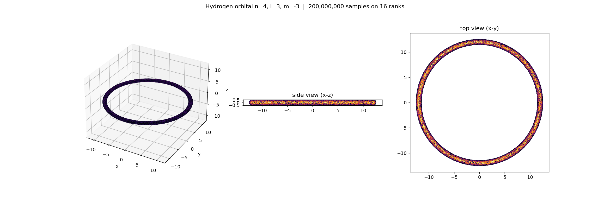

# Hydrogen orbital simulation — MPI Monte Carlo visualization

## Objective

Numerically sample hydrogenic wavefunction probability densities \(|\psi_{n\ell m}|^2\) and visualize three-dimensional orbitals, using `mpi4py` to distribute Monte Carlo samples across cluster ranks.

The **archived benchmark implementation** is [`Hydrogen-Orbital-Results/code/orbital2.py`](Hydrogen-Orbital-Results/code/orbital2.py), submitted with [`orbital2.sbatch`](Hydrogen-Orbital-Results/code/orbital2.sbatch). Earlier files such as `or.py`, `or_mpi4py.py`, and `or_mpi4py_vertices.py` are development/prototype variants, not the source of the reported benchmark measurements.

## Computational approach

Each rank independently samples radial, polar, and azimuthal coordinates, evaluates normalized hydrogenic radial and spherical-harmonic factors, computes importance-sampling weights, and contributes to reductions estimating normalization and expected radius. Only selected high-density points are gathered to rank zero for plotting. The calculation uses Bohr-radius units with \(a_0 = 1\) internally.

## Measured results

A fixed orbital \((n,l,m)=(4,3,-3)\) with **25 million samples** was measured at:

| MPI ranks | Nodes | Total compute time | Speedup vs 1 rank |
|---:|---:|---:|---:|
| 1 | 1 | 9.1 s | 1.0× |
| 4 | 1 | 3.1 s | 2.9× |
| 16 | 4 | 0.8 s | 11.4× |

Three 200-million-sample runs used 16 ranks; for `(4,3,-3)`, the recorded total compute time was **6.1 s**, with normalization **0.99985 ± 0.00012** and estimated expected radius **17.9986** versus exact **18** Bohr radii. These figures come from [`results.md`](Hydrogen-Orbital-Results/results.md). Note that “total compute” in the recorded table may not equal whole Slurm job wall time or PNG rendering time.

## Visual results

The six PNGs for representative quantum numbers, sample counts, and rank counts are in [`images/`](Hydrogen-Orbital-Results/images/). For example:



These images show **proposal-distribution samples filtered by computed probability density**, then colored according to density. They are neither independent draws from the exact electron-position distribution nor measured electron positions or classical orbits.

## Run a smaller new job

```bash
REPO="$(git rev-parse --show-toplevel)"
mkdir -p "$HOME/jobs/orbital"
cp "$REPO/Hydrogen Orbiatal Simulations/Hydrogen-Orbital-Results/code/"{orbital2.py,orbital2.sbatch} "$HOME/jobs/orbital/"
cd "$HOME/jobs/orbital"
sbatch -N1 --ntasks-per-node=4 orbital2.sbatch 4 3 -3 1000000 0.001
```

**Prerequisites:** Open MPI, matching `mpi4py`, NumPy, SciPy, Matplotlib, and a shared `~/jobs/orbital` directory. The archived batch script hardcodes `/usr/lib64/openmpi/bin` and the cluster NIC selector `192.168.10.0/24`; verify both before running outside the original environment.

## Limitations

- The original benchmark used 1/4/16-rank scaling, but each configuration was run only once; further repetitions would quantify variance.
- Sampling/importance-weighting estimates come with Monte Carlo uncertainty and must not be confused with exact numerical solutions.
- The unbenchmarked orbital prototypes now include a SciPy 1.13-compatible spherical harmonic fallback and save plots on headless Linux systems. Their scientific and MPI behavior has **not** been benchmark-validated; use `orbital2.py` for reported measurements.

[Full results](Hydrogen-Orbital-Results/results.md) · [Historic submissions](Hydrogen-Orbital-Results/slurm_commands.md) · [Original logs](Hydrogen-Orbital-Results/logs/)
