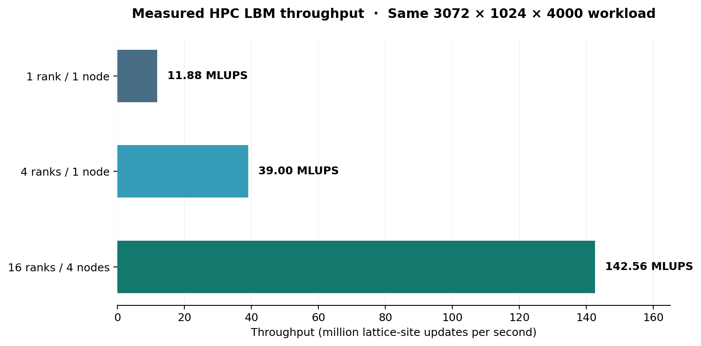

# Lattice Boltzmann — standardized HPC results

This folder is the complete, reproducible results record for a **2D D2Q9 BGK Lattice Boltzmann simulation of cylinder wake flow and von Kármán vortex shedding**. It contains both the actual solver/Slurm output and a video generated on a **four-node (16-rank) Rocky Linux cluster**.


**[Watch `vortex.mp4`](video/vortex.mp4)** · [Detailed measurements](results.md) · [Per-node environment](environment.md) · [Exact historical job scripts](code/historical/) · [Original Slurm logs](logs/README.md)

## What was executed

- **Correctness comparison:** jobs **91** (1 rank, one node) and **92** (16 ranks, four nodes), each 640×256 for 800 steps and 8 output frames. The operator's comparison returned `PASS: FRAMES IDENTICAL`; raw solver logs are preserved, but source frame checksums weren't uploaded.
- **Identical-workload performance benchmarks:** jobs **93**, **94**, **95**, same 3072×1024×4000 problem across 1, 4, and 16 ranks; 0 frame files by design.
- **Production:** job **96**, 2048×768×80,000, cylinder D=96, Re=120, 16 MPI ranks across `node01–04`; emitted **289 image frames** and completed in **897.84 s** at **140.15 MLUPS**.
- **Video:** dependent job **97** encoded those frames into [`video/vortex.mp4`](video/vortex.mp4), a **1024×384, H.264, 24 FPS, 12.04 s** clip. Encoder wall time was not captured.

## Actual scaling results

| Slurm job | Ranks | Nodes | Solver wall time | Measured rate | Speedup |
|---:|---:|---:|---:|---:|---:|
| 93 | 1 | 1 | 1059.16 s | 11.88 MLUPS | 1.00× |
| 94 | 4 | 1 | 322.65 s | 39.00 MLUPS | 3.28× |
| 95 | 16 | 4 | 88.26 s | 142.56 MLUPS | 12.00× |



**Verified hardware:** four Intel **i5-2400** compute nodes, each 4 cores and 15 GiB Linux-visible memory, with NICs reporting 1000 Mb/s links; a separate **i5-4460S** admin node. All use Rocky Linux **9.8**. These values correct previous descriptions of the cluster as entirely i5-4460 hardware. See [environment.md](environment.md) and original hardware reports for all kernel/versions.

## How to read the outputs

The obstacle is a stationary cylinder; red/blue regions are opposite signs of **fluid vorticity**, indicating opposite senses of local rotation. The animation covers sampled simulation steps 8,000–80,000, not actual real-world fluid time. The alternating wake is qualitatively consistent with a **von Kármán vortex street**, but shedding frequency, Strouhal number, drag/lift, and mesh convergence remain unmeasured. The clip alone is not quantitative CFD validation.

## Data quality and limitations

- Original stdout for **jobs 91–97** is now archived and referenced (see `logs/`). Production job 96's final runtime is **verified**.
- Slurm accounting reports **`Slurm accounting storage is disabled`**, so historical MaxRSS, AveRSS and Slurm step-accounting values are **unavailable**.
- **Fastest and slowest MPI ranks, detailed per-rank output, and time per node are N/R** for historical runs because the solver did not instrument them. A later profiling job can provide these only for a *new* run.
- Node `free -h` snapshots and 1000 Mb/s NIC **link** speeds are real but are **not** workload peak RAM or achieved network bandwidth.
- A proposed significantly larger capacity test was *not executed* here.

## Folder layout

```text
Lattice-Boltzmann-Results/
├── README.md                # What ran, how to read it, caveats, reproduction
├── results.md               # Every job, measured wall time/rate, missing per-rank/memory metrics
├── environment.md           # All 5 nodes: CPU, RAM, NIC, OS/kernel, and versions
├── slurm_commands.md        # Exact historical commands + batch files + reproduction
├── code/                    # Solver, Slurm scripts, historical originals, optional profilers
├── logs/                    # Actual job output, original hardware reports, accounting status
├── images/                  # Actual final frame / contact sheet; benchmark chart
├── video/                   # Original MP4
└── data/                    # Benchmarks and production metadata in machine-readable formats
```

## Reproduce on the Rocky Linux cluster

From this `Lattice-Boltzmann-Results/` directory on the shared filesystem:

```bash
mkdir -p logs runs
export PATH=/usr/lib64/openmpi/bin:$PATH
bash code/build.sh
bash code/benchmark.sh       # submits 3 new, dependency-ordered performance jobs
bash code/run-production.sh  # submits a new 16-rank production + encoder job
cat prod.jobs
```

The current `code/lbm.sbatch` and `code/encode.sbatch` are portable **reproduction variants** of the job scripts; exact scripts copied directly from the historical HPC run are under [`code/historical/`](code/historical/). From a **Linux Bash terminal**, you can copy a newly encoded video from the admin node to another Linux machine using `scp hpc@YOUR_ADMIN_HOST:/ABSOLUTE/PATH/TO/runs/prod-JOBID/vortex.mp4 ./vortex.mp4`. Run that command on the receiving Linux machine, not inside the admin-node SSH session. The original video from job 97 is already included under `video/`.

[Detailed results and primary evidence](results.md) · [Environment](environment.md) · [Slurm submissions](slurm_commands.md) · [Images](images/README.md) · [Video](video/README.md)
