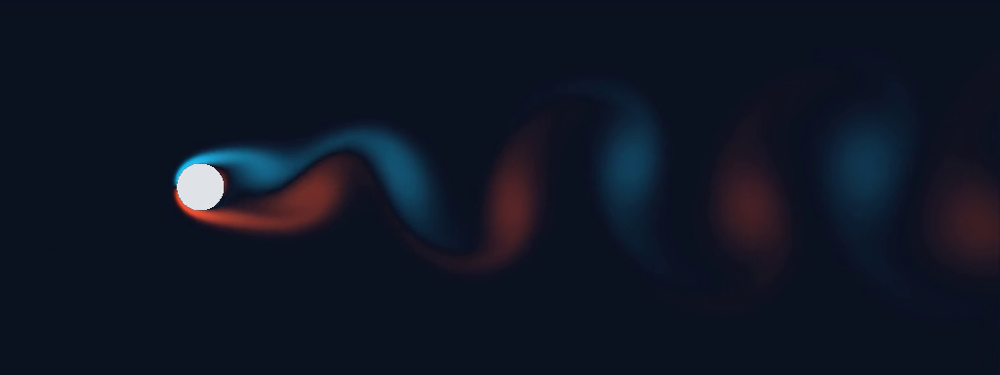
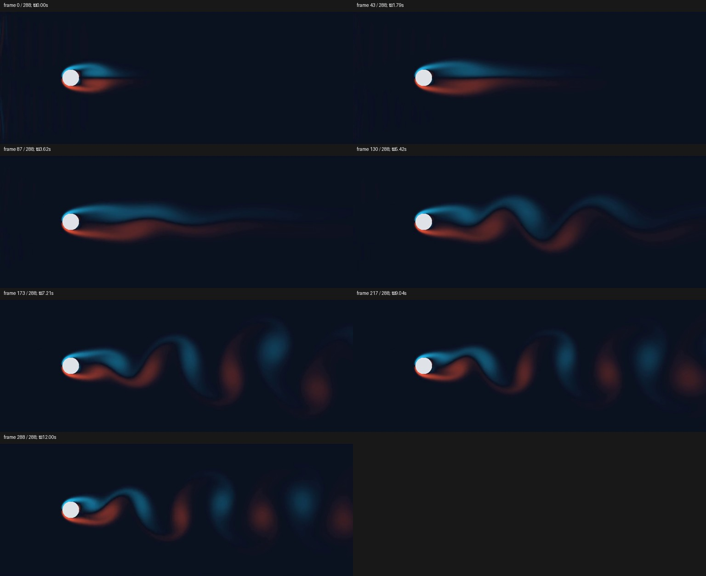
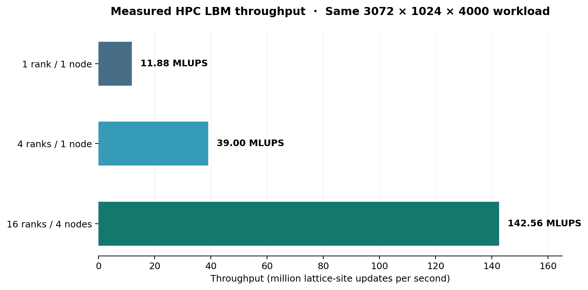

# Images — context, simulation steps, and MPI process counts

## 1. Actual final vorticity frame (production job 96)

- **Simulation time:** final frame corresponding to **step 80,000** of 80,000.
- **MPI ranks:** 16 total, **4 ranks on each of 4 nodes**.
- **Grid/source:** 2048×768 simulation downsampled by stride 2 to **1024×384**.
- **Observable:** color-coded signed vorticity (not particle trajectories or temperatures).

## 2. Wake development contact sheet (production job 96)

- **Simulation time:** selected frames from **steps 8,000–80,000** (250 steps between all original frames).
- **MPI ranks:** **16** across **4 compute nodes**.
- **Source:** the original `video/vortex.mp4`, compiled from 289 PPM frames.

## 3. Measured benchmark throughput (jobs 93, 94, 95)

- **Simulation time:** **4,000 steps** for each job, with frame recording disabled.
- **Rank counts:** **1, 4, 16** MPI ranks respectively; nodes **1, 1, 4** respectively.
- **Grid:** **3072 × 1024** in all three jobs (same workload).

