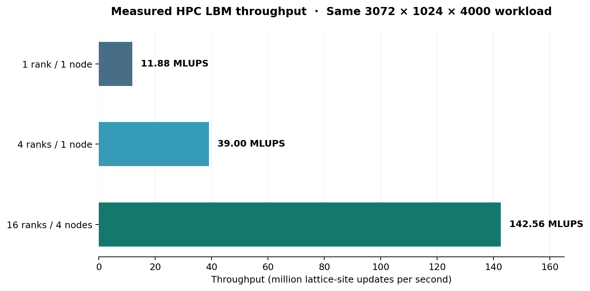

# Results — verified HPC run records

**Evidence:** original Slurm stdout files `logs/lbm-91.out` through `logs/lbm-96.out`, video-encoder log `logs/enc-97.out`, and node inventories under `logs/hardware/`, exported from the actual Rocky Linux cluster on 21 November 2026 (Qatar time). **N/R** means not recorded, *not* zero. Wall times below are **solver-reported wall times**, not Slurm accounting totals; Slurm accounting is disabled at this site (`logs/slurm-accounting-status.txt`).

## 1. Slurm jobs and exact workload

| Job | Purpose | Nodes | Ranks | Tasks/node | Time steps | Input settings | Outcome |
|---|---|---:|---:|---:|---:|---|---|
| **91** | Frame-equivalence baseline (`eq1`) | 1 (`node01`) | 1 | 1 | 800 | `640×256`, D=32, Re=100 | 8 frames; finished |
| **92** | Frame-equivalence MPI (`eq16`) | 4 (`node01–04`) | 16 | 4 | 800 | Same as job 91 | 8 frames; finished |
| **93** | Benchmark (`bench1`) | 1 (`node01`) | 1 | 1 | 4,000 | `3072×1024`, D=128, Re=120 | 0 frames by design; finished |
| **94** | Benchmark (`bench4`) | 1 (`node01`) | 4 | 4 | 4,000 | Same as job 93 | 0 frames by design; finished |
| **95** | Benchmark (`bench16`) | 4 (`node01–04`) | 16 | 4 | 4,000 | Same as job 93 | 0 frames by design; finished |
| **96** | Production cylinder flow (`prod`) | 4 (`node01–04`) | 16 | 4 | 80,000 | `2048×768`, D=96, Re=120 | **289 frames; finished** |
| **97** | H.264 video encoding | 1 (node not logged) | N/A | 1 Slurm task | N/A | `runs/prod-96`, 24 FPS | MP4 created; no recorded wall time |

The exact argument strings are preserved in the **first line of each original solver log** and transcribed in [`slurm_commands.md`](slurm_commands.md).

## 2. Measured timing and scaling

| Job | Nodes | MPI ranks | Solver wall time | Measured MLUPS | Speedup vs job 93 | Parallel efficiency |
|---|---:|---:|---:|---:|---:|---:|
| 91 (short test) | 1 | 1 | **11.74 s** | **11.17** | N/A | N/A |
| 92 (short test) | 4 | 16 | **1.27 s** | **103.59** | N/A (different workload) | N/A |
| **93** | 1 | 1 | **1059.16 s** | **11.88** | **1.00×** | 100% |
| **94** | 1 | 4 | **322.65 s** | **39.00** | **3.28×** | **82.1%** |
| **95** | 4 | 16 | **88.26 s** | **142.56** | **12.00×** | **75.0%** |
| **96** | 4 | 16 | **897.84 s** | **140.15** | N/A (different workload) | N/A |
| 97 | 1 | non-MPI | **N/R** | N/A | N/A | N/A |



For jobs 93–95, the *identical* benchmark performed **12,582,912,000 nominal lattice-site updates**. Thus, the 16-rank throughput is **12.00×** the single-rank result, with **75.0%** parallel efficiency relative to a single-rank baseline. Only the compute-node processors (i5-2400) participated in these jobs; the admin CPU is not a compute-node processor.

### Required per-rank, per-node and memory metrics

| Job | Fastest rank (seconds) | Slowest rank (seconds) | Per-rank details | Per-node execution times | Measured peak RSS by rank or node |
|---|---|---|---|---|---|
| 91 | N/R | N/R | N/R | N/R | N/R |
| 92 | N/R | N/R | N/R | N/R | N/R |
| 93 | N/R | N/R | N/R | N/R | N/R |
| 94 | N/R | N/R | N/R | N/R | N/R |
| 95 | N/R | N/R | N/R | N/R | N/R |
| 96 | N/R | N/R | N/R | N/R | N/R |
| 97 | N/A (non-MPI) | N/A (non-MPI) | N/A | N/R | N/R |

**Why these fields remain unavailable:** the original solver logs reported a single overall elapsed value from rank 0 but did not instrument or report execution times or memory consumption for individual MPI ranks. `sacct` returned the explicit message **“Slurm accounting storage is disabled”**; thus no historical `MaxRSS`, `AveRSS`, or Slurm job-step timing records can be retrieved from accounting. The four nodes' `free -h` values are **point-in-time snapshots collected later**, not workload peaks. For a **new** profiling run, use [`code/lbm-profiled.sbatch`](code/lbm-profiled.sbatch) and [`code/summarize_profile.py`](code/summarize_profile.py), then report it as a *different* job, not retroactive measurements for jobs 91–97.

## 3. Production run 96 — actual output and settings

| Property | Verified value |
|---|---|
| Run start / end (cluster local) | 20 Nov 2026 **21:22:54** / **21:37:52** |
| Solver | C/MPI D2Q9 BGK Lattice Boltzmann |
| Geometry | 2-D domain with a fixed circular cylinder |
| Grid | **2048 × 768** (1,572,864 lattice cells) |
| Steps | **80,000** |
| Nominal lattice updates | **125,829,120,000** (125.8 billion) |
| Reynolds number | **120** |
| Cylinder diameter | **96** cells |
| Inlet lattice speed | **0.06** |
| Kinematic lattice viscosity | **0.048** |
| BGK relaxation parameter | **τ = 0.644** |
| Parallel execution | `node[01-04]`, 16 ranks, 4 ranks/node |
| Completed solver runtime | **897.84 s** (14 min 57.84 s) |
| Completed production throughput | **140.15 MLUPS** |
| Output frames | **289** sampled every 250 steps starting at step 8,000 |
| Output resolution | 1024 × 384 pixels (spatial stride 2) |
| Encoded video | [`video/vortex.mp4`](video/vortex.mp4): H.264, 24 FPS, approximately 12.04 seconds |
| FFmpeg encoder | 7.0.2-static, see `logs/enc-97.out` |
| Encoder wall time | **N/R** (encoder log has no measured execution elapsed) |
| Scientific validation | Vortex wake visually observed; shedding frequency, Strouhal number, drag/lift and mesh convergence not measured |

**Final production log statement:**

```text
Finished: 289 frames, wall time 897.84 s, average 140.15 million lattice updates/sec
```


## 4. Correctness, physics and caveats

- Jobs **91** and **92** completed with 8 rendered frames each, on 1 vs 16 ranks. The operator's subsequent `diff` test reported **`PASS: FRAMES IDENTICAL`**. The archive contains the solver logs, but **not** the original frame files and hashes to independently rerun this comparison here.
- The production MP4 visually depicts alternating signed-vorticity structures downstream of the obstacle. This is consistent with a von Kármán vortex street but **does not quantify** shedding frequency, Strouhal number, vortex forces or convergence to a physically validated solution.
- Periodic upper and lower boundaries and a zero-gradient downstream boundary are approximations that can affect the wake and require further study.
- The proposed 6144×2048 or memory-scale runs have **not** been documented as executed experiments. Do not report their configurations as measured hardware utilization.
- The sampled 1,000-step mass values in the logs have limited printed precision; they are not a completed rigorous mass-budget validation.

## 5. Primary evidence files

- [`logs/lbm-91.out`](logs/lbm-91.out) and [`logs/lbm-92.out`](logs/lbm-92.out): correctness runs.
- [`logs/lbm-93.out`](logs/lbm-93.out), [`logs/lbm-94.out`](logs/lbm-94.out), [`logs/lbm-95.out`](logs/lbm-95.out): rank-scaling benchmarks.
- [`logs/lbm-96.out`](logs/lbm-96.out): complete 80,000-step production log.
- [`logs/enc-97.out`](logs/enc-97.out): the actual FFmpeg encoding console output.
- [`logs/slurm-accounting-status.txt`](logs/slurm-accounting-status.txt): why Slurm memory/timing accounting is unavailable.
- [`logs/hardware/`](logs/hardware/): original five-node OS/CPU/RAM/NIC and tool-version snapshots.
