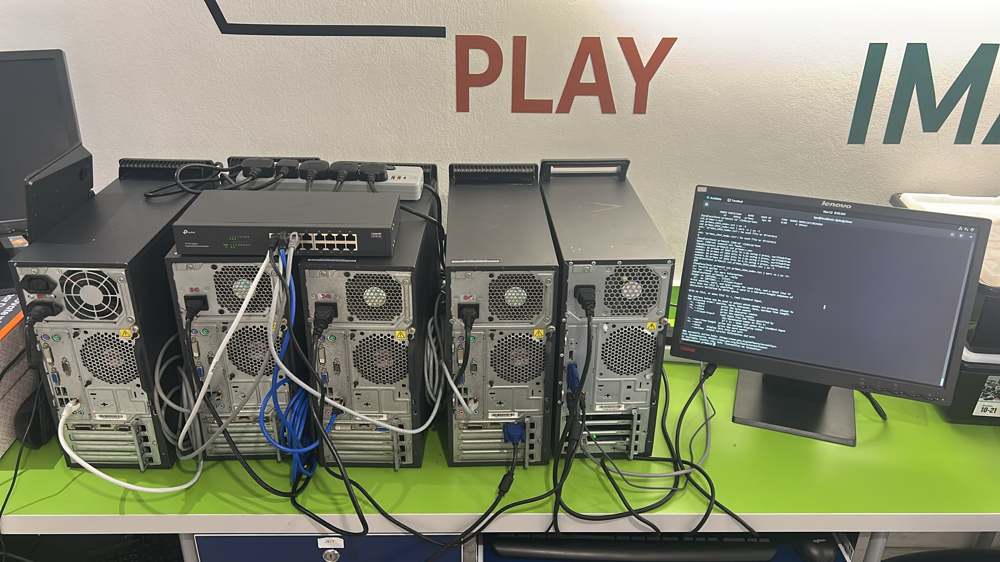

# OpenHPC Cluster Infrastructure

 A student-led High Performance Computing (HPC) project built using repurposed desktop hardware, Rocky Linux 9.8 on the administrator, and the OpenHPC software ecosystem.
 The project focuses on cluster infrastructure, node provisioning, workload scheduling, networking, shared storage, and parallel computing.
 Developed as a long-term educational resource, it aims to make practical scientific computing and HPC system administration more accessible within a school environment.

*Physical five-node cluster with a TP-Link LS1016G Gigabit switch. See the [photo gallery](docs/PHOTO_GALLERY.md) for individual node consoles and other views.*

## Project Timeline and Team Contributions

**[Read the Project Timeline and Team Contributions (August–November 2026)](docs/PROJECT_TIMELINE_AND_TEAM_CONTRIBUTIONS.md)** — A month-by-month account of the cluster build, team responsibilities, configuration work, troubleshooting, and simulations.

---

## Overview

The **OpenHPC Cluster Infrastructure** project documents the design, configuration, and development of a multi-node High Performance Computing cluster. It combines established open-source HPC technologies with repurposed hardware to create a platform for learning distributed computing and supporting computational workloads.

The infrastructure consists of five desktop PCs configured as one admin node and four compute nodes. The admin node provides centralized cluster management, while the compute nodes are intended to execute scheduled parallel and scientific workloads.

The systems comprise a mix of Lenovo ThinkCentre E71, E73, and M71 models. They are interconnected through a TP-Link LS1016G unmanaged Gigabit Ethernet switch.

This repository also serves as a technical reference for the actual cluster configuration, documenting the software stack and component-specific configuration files used during deployment.

## Team

| Member                           | Role and Responsibilities                                                  |
| -------------------------------  | -------------------------------------------------------------------------- |
| **Shanmukha Sainath Kasireddy**  | Project Lead · Cluster Setup & Administration · Slurm · Simulations        |
| **Eric Bipin Philip**            | Cluster Provisioning · Linux Administration · Troubleshooting              |
| **Aayush Pal**                   | Simulations · Performance Analysis                                         |

*HPC project team in the school robotics lab. See the [photo gallery](docs/PHOTO_GALLERY.md) for additional photographs.*

## Hardware Architecture

The cluster is built from five repurposed Lenovo ThinkCentre desktop PCs, using a dedicated management node and four compute nodes connected through an unmanaged Gigabit Ethernet switch.

### Admin Node

| Component    | Specification                                |
| ------------ | -------------------------------------------- |
| Quantity     | 1                                            |
| Processor    | Intel(R) Core(TM) i5-4460S CPU @ 2.90 GHz    |
| Memory       | 16 GB DDR3                                   |
| Storage      | 128 GB nominal SSD (119.2 GiB disk observed)                                   |
| Network      | Gigabit Ethernet                             |
| Primary Role | Cluster management and administration        |

The admin node hosts the cluster management services, including the Slurm controller, Warewulf, NFS, and SSH, as configured for the deployment.

### Compute Nodes

| Component               | Specification                                  |
| ----------------------- | ---------------------------------------------- |
| Quantity                | 4                                              |
| Processor               | Intel(R) Core(TM) i5-2400 CPU @ 3.10 GHz       |
| Memory                  | 16 GB DDR3 per node                            |
| Combined Compute Memory | 64 GB DDR3                                     |
| Network                 | Gigabit Ethernet                               |
| Primary Role            | Scheduled parallel and scientific workloads    |

### Aggregate Resources

| Resource                | Specification                        |
| ----------------------- | ------------------------------------ |
| Total Nodes             | 5                                    |
| Admin Nodes             | 1                                    |
| Compute Nodes           | 4                                    |
| Desktop Models          | Lenovo ThinkCentre E71, E73, and M71 |
| Total Installed Memory  | 80 GB DDR3                           |
| Combined Compute Memory | 64 GB DDR3                           |
| Network Switch          | TP-Link LS1016G                      |
| Switch Type             | Unmanaged                            |
| Network Infrastructure  | Gigabit Ethernet                     |

*Memory totals represent installed physical RAM across all five nodes, not memory available to a single job.*

## Software Stack

The infrastructure uses open-source tools for provisioning, workload scheduling, authentication, networking, and shared file access.

| Component                 | Technology                       | Purpose                                                      |
| ------------------------- | -------------------------------- | ------------------------------------------------------------ |
| Operating System          | Rocky Linux 9.8 (admin node)     | Linux environment for cluster services and compute workloads |
| HPC Software Distribution | OpenHPC                          | HPC software integration and deployment tooling              |
| Node Provisioning         | Warewulf                         | Compute-node image and provisioning management               |
| Workload Manager          | Slurm                            | Job scheduling and allocation of cluster resources           |
| Authentication            | Munge                            | Authentication for Slurm-related services                    |
| Message Passing           | OpenMPI                          | MPI-based parallel computing                                 |
| Shared File Access        | NFS                              | Network-based file sharing                                   |
| Remote Administration     | SSH                              | Secure remote access and administration                      |
| Network Management        | Linux networking and `firewalld` | Interface configuration, addressing, and traffic control     |

*The table describes the roles of the software components; successful operation of each service depends on the deployed configuration and verification.*

## Verified Deployment — 23rd November 2026

The five-node OpenHPC cluster (1 administrator + 4 compute nodes) was verified operational using Slurm.

- **Compute resources:** 16 CPU cores and 60,000 MB of Slurm-configured memory across four nodes.
- **Node status:** All four compute nodes reported `idle`.
- **Services:** Munge, Slurm controller, and Warewulf services confirmed active.
- **Distributed execution:** A four-node Slurm `srun` test successfully executed tasks on `node01`–`node04`.

The verification confirms successful Slurm task execution across all four compute nodes at the time of testing. Full MPI validation and post-reboot provisioning tests remain separate.

For hardware specifications, software versions, networking, storage, and detailed verification evidence, see [`docs/LIVE_CONFIGURATION.md`](docs/LIVE_CONFIGURATION.md).

*Note: Configuration references include historical examples and should not be treated as a complete automated installation procedure.*

## Documentation index

| Topic | Where to read |
|---|---|
| Architecture and service flows | [Architecture](docs/ARCHITECTURE.md) |
| Hardware inventory | [Hardware Inventory](docs/HARDWARE_INVENTORY.md) |
| Versions and compatibility | [Software Stack](docs/SOFTWARE_STACK.md) |
| System build sequence | [Build Guide](docs/CLUSTER_BUILD_GUIDE.md) |
| Image, profiles, overlays, PXE | [Provisioning](docs/PROVISIONING.md) |
| Shared NFS paths | [Storage](docs/STORAGE.md) |
| Firewall and security review | [Networking & Security](docs/NETWORKING_AND_SECURITY.md) |
| Dated live evidence | [Live Configuration](docs/LIVE_CONFIGURATION.md) |
| Verification matrix | [Validation](docs/VALIDATION.md) |
| Daily read-only checks | [Operations](docs/OPERATIONS.md) |
| Config-by-config audit | [Configuration Catalog](docs/CONFIG_CATALOG.md) |
| Known gaps | [Known Limitations](docs/KNOWN_LIMITATIONS.md) |
| Development history | [Project Timeline and Team Contributions](docs/PROJECT_TIMELINE_AND_TEAM_CONTRIBUTIONS.md) and [Troubleshooting](troubleshooting.md) |
| Photos of the physical cluster and node consoles | [Photo Gallery](docs/PHOTO_GALLERY.md) |

**Evidence convention:** *verified* = visible in 2026-11-23 live command output; *historical* = older build notes; *planned* = not yet deployed/tested. Please do not mistake archived shell commands ending in `.conf` for production-ready installers.

## Configuration Reference

The repository contains component-specific reference files extracted and organized from historical build notes, now annotated with selected live settings verified on 23 November 2026. These are **not guaranteed byte-for-byte copies of active `/etc` files**. See the dated live record before reusing anything.

### Configuration Directory

| Directory               | Contents                                                          |
| ----------------------- | ----------------------------------------------------------------- |
| [`warewulf/`](warewulf/)     | Server, image, profile, node, and overlay configuration           |
| [`slurm/`](slurm/)        | Slurm controller and compute-node configuration                   |
| [`munge/`](munge/)        | Munge setup and authentication configuration; secret key excluded |
| [`nfs/`](nfs/)          | NFS setup, exports, and shared-storage configuration              |
| [`firewall/`](firewall/)     | `firewalld` rules and firewall configuration                      |
| [`networking/`](networking/)   | Cluster addressing and network-interface configuration            |
| [`system/`](system/)       | System packages, services, and related settings                   |
| [`verification/`](verification/) | Commands used to inspect and verify cluster components            |

The configuration files are intended for technical inspection, learning, troubleshooting, and adaptation. They are **not a one-command installer or a complete automated deployment system**.

### Configuration Notes

* **Hardware-specific settings:** IP addresses, interface names, MAC addresses, hostnames, and other environment-dependent values may need to be changed for another deployment.
* **Version compatibility:** Package versions, configuration syntax, and service behavior may differ between software releases.
* **Troubleshooting history:** Where identifiable, corrected commands and final configuration forms are documented instead of presenting failed terminal attempts as valid configuration.
* **Security:** Real passwords and authentication secrets are excluded. A new deployment must generate and securely distribute its own Munge key.
* **Verification:** Configuration examples should be reviewed and tested against the target environment before use.
* **Historical commands:** Files ending in `.conf` in this repository may contain shell command transcripts or notes instead of native daemon configuration. **Do not run the files as shell scripts**. Inspect commands individually and avoid re-running bootstrap steps against a working cluster.
* **Public repository:** Do not commit Munge keys, host private keys, passwords, Tailscale credentials, or unsanitized live configuration dumps.

## Simulation Workloads

Four desktops completed the fixed CFD problem in **88.26 s**, versus **322.65 s** on all four cores of one desktop (**3.66×**). The 50-billion sieve distributed **23.28 GiB** of arrays and finished in **68.9 s**. [Benchmark verification and comparison](https://github.com/Programmer-Sainath/OpenHPC-Cluster/blob/Simulation-Workloads/benchmark-review/README.md)

Scientific applications and simulation-related work are maintained separately to keep the infrastructure documentation focused on cluster deployment and management.

See the [**Simulation Workloads branch**](https://github.com/Programmer-Sainath/OpenHPC-Cluster/tree/Simulation-Workloads) for the project's computational workloads and related development.

The intended application areas include computational physics, mathematical modelling, numerical methods, and Computational Fluid Dynamics (CFD).

## Acknowledgements

We gratefully acknowledge **DPS-Modern Indian School** for providing the hardware and access to the school's robotics lab for the development of this cluster.

We also acknowledge the **OpenHPC community** and the broader open-source ecosystem for the software, tools, and documentation that support accessible High Performance Computing.

## License

See the [`LICENSE`](LICENSE) file for the terms governing the use, modification, and distribution of this repository.
