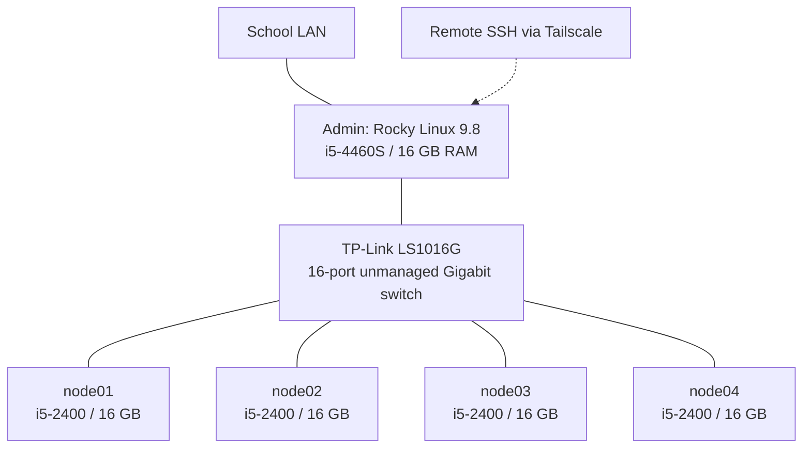
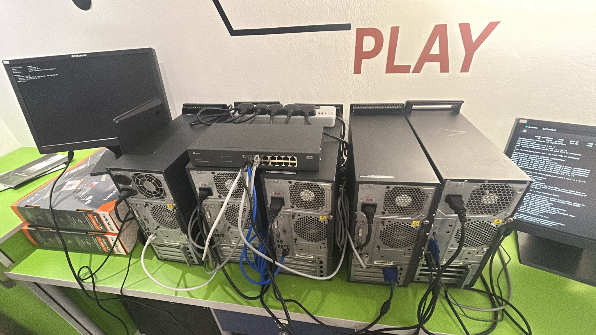

# Architecture and data flow

## Five-node topology

The admin is connected to the **school network** through `enp2s0` and to the **private cluster LAN** through `enp3s0` (`192.168.10.2/24`). Its Slurm controller, Warewulf provisioning services, Munge, DHCP, TFTP/iPXE, NFS and Chrony support the compute nodes. This is a logical service diagram, not a verified port-by-port cable map.

## Physical cluster photograph

*Photograph of the assembled desktop nodes and cabling. This shows the physical installation, not a measured link-speed or port-level connectivity test. See the [photo gallery](PHOTO_GALLERY.md).*

## Job and provisioning life cycles

1. **Provisioning (known deployment architecture):** Compute firmware PXE boots through the cluster switch; Warewulf-managed DHCP/TFTP/iPXE tells it where to obtain its image and overlays. The `rockylinux-9` image, `default` profile, and four node records were observed, but boot packet captures and restart tests were not collected.
2. **Execution (verified):** A user requests Slurm resources; `slurmctld` at `192.168.10.2` assigns jobs to `slurmd` on `node01`–`node04`; Munge supports Slurm authentication. A four-node hostname job succeeded on 2026-11-23.
3. **Storage (verified):** `/home` is exported by NFS on the admin and mounted by all four nodes as `warewulf:/home` using NFSv4.2. The admin home LV is the shared storage; this is **not four independent 40GB drives**.
4. **Scientific applications:** MPI executables and simulation benchmarks are documented in the [Simulation Workloads branch](https://github.com/Programmer-Sainath/OpenHPC-Cluster/tree/Simulation-Workloads). The infrastructure audit did not re-run those simulations.

## Engineering characteristics

- **Cluster type:** small, single-admin-node educational HPC system with four diskless compute nodes.
- **Scheduling capacity:** 16 compute CPUs, 60,000 MB Slurm-advertised memory; admin CPU/RAM are for control-plane work, not included in the four-node Slurm partition.
- **Network:** Gigabit Ethernet via unmanaged switch (no verified VLAN segmentation). Inter-node throughput/latency were not benchmarked in this audit.
- **Failure domains:** The admin provides provisioning, scheduling, and shared `/home`; its loss affects services across the cluster. No HA controllers, redundant NFS server, or automatic failover are verified.
- **Operational boundary:** All documented inspections target Rocky Linux Bash; no commands in the repository are intended for Windows execution.
