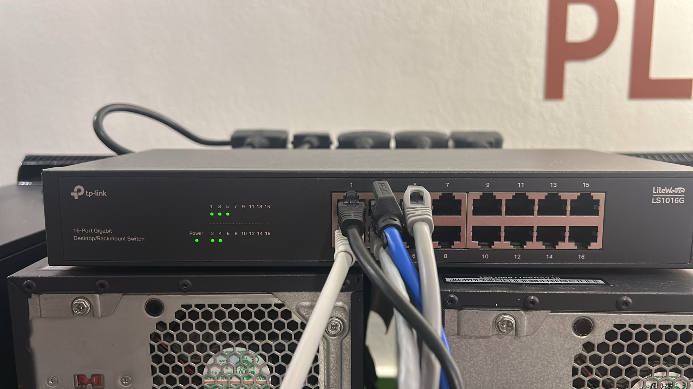

# Hardware inventory

**Verification date:** 2026-11-23. CPU models and Linux memory values were read with `lscpu` and `/proc/meminfo`. Desktop model families, RAM technology, switch, and nominal SSD capacity come from team inventory rather than hardware DMI validation.

| ID | Role | CPU / logical CPUs | Linux `MemTotal` | Storage | LAN |
|---|---|---|---:|---|---|
| Admin (`localhost`) | Slurm, NFS, Warewulf, DHCP, Chrony | i5-4460S @ 2.90GHz / 4 | 16,021,612 kB | `sda` 119.2 GiB, LVM, XFS, EFI | `enp3s0` private; `enp2s0` school |
| `node01` | Compute | i5-2400 @ 3.10GHz / 4 | 16,355,200 kB | Diskless RAM-based rootfs | Private Gigabit LAN |
| `node02` | Compute | i5-2400 @ 3.10GHz / 4 | 16,355,180 kB | Diskless RAM-based rootfs | Private Gigabit LAN |
| `node03` | Compute | i5-2400 @ 3.10GHz / 4 | 16,355,180 kB | Diskless RAM-based rootfs | Private Gigabit LAN |
| `node04` | Compute | i5-2400 @ 3.10GHz / 4 | 16,355,176 kB | Diskless RAM-based rootfs | Private Gigabit LAN |

Admin partitioning observed: EFI 600 MiB, `/boot` 1 GiB, XFS LVM `/` 70 GiB, `/home` 39.8 GiB, swap 7.8 GiB. `lsblk` also showed an `sdb` device reporting **0 B**; do not describe that as a usable storage drive.

**Totals:** 5 CPUs × 4 logical CPU resources = 20 across the five machines. The compute partition contains 16 Slurm-schedulable CPUs. Nominal RAM: 16 GB per machine, 80 GB aggregate; **64 GB nominal compute-node RAM**, of which Slurm advertises 60,000 MB. Those quantities are different measurements and must not be conflated.

Network switch from team inventory: **TP-Link LS1016G unmanaged 16-port Gigabit Ethernet**; an earlier Cisco Catalyst switch was replaced during development. Device MAC addresses appear in the historical `networking/cluster-layout.conf` and should be treated as internal machine identifiers, not authentication credentials. Avoid adding serial numbers or photos containing visible asset tags to a public repo without school approval.

## Switch photograph

*The front panel identifies the TP-Link LiteWave LS1016G; a closer view of the assembled cluster and additional photos are in the [photo gallery](PHOTO_GALLERY.md). The photo does not by itself establish throughput or detailed port mapping.*
