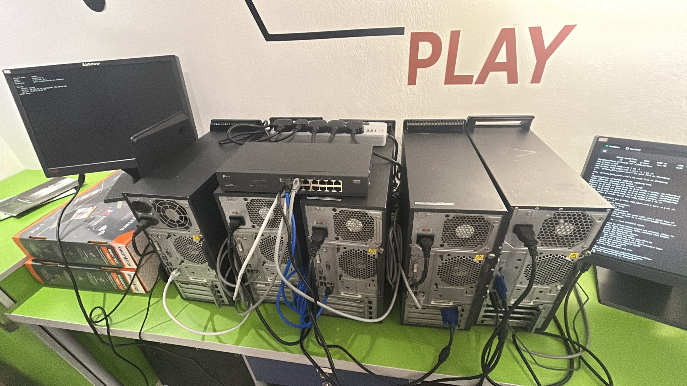
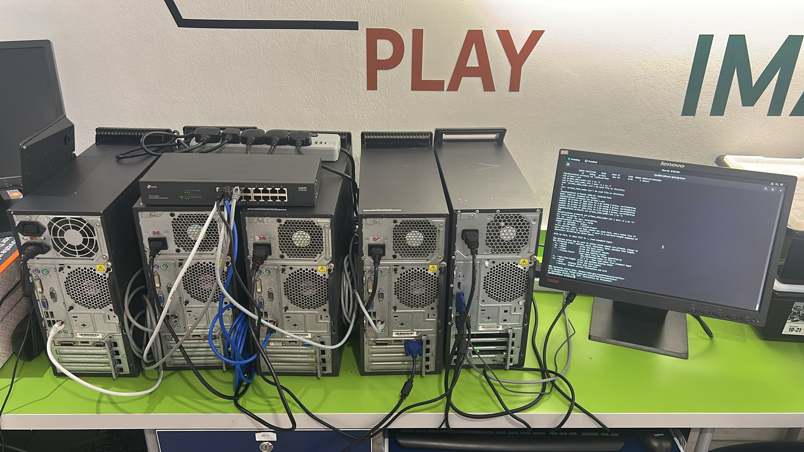
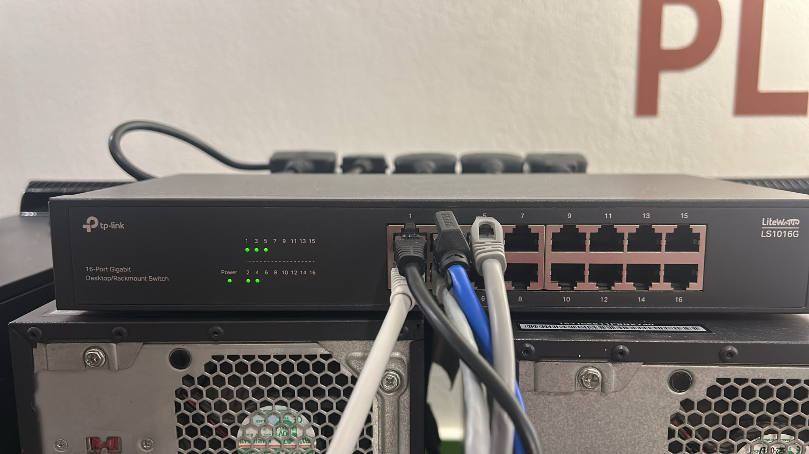
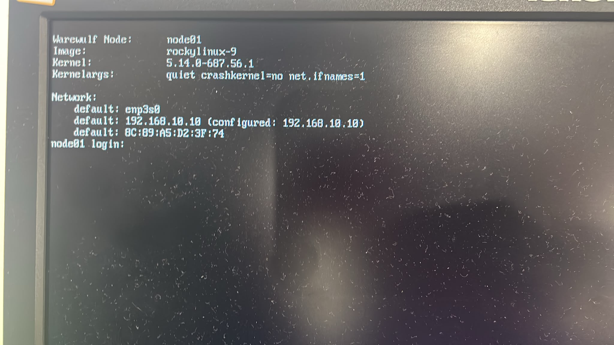
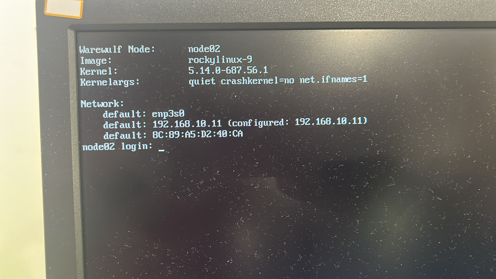
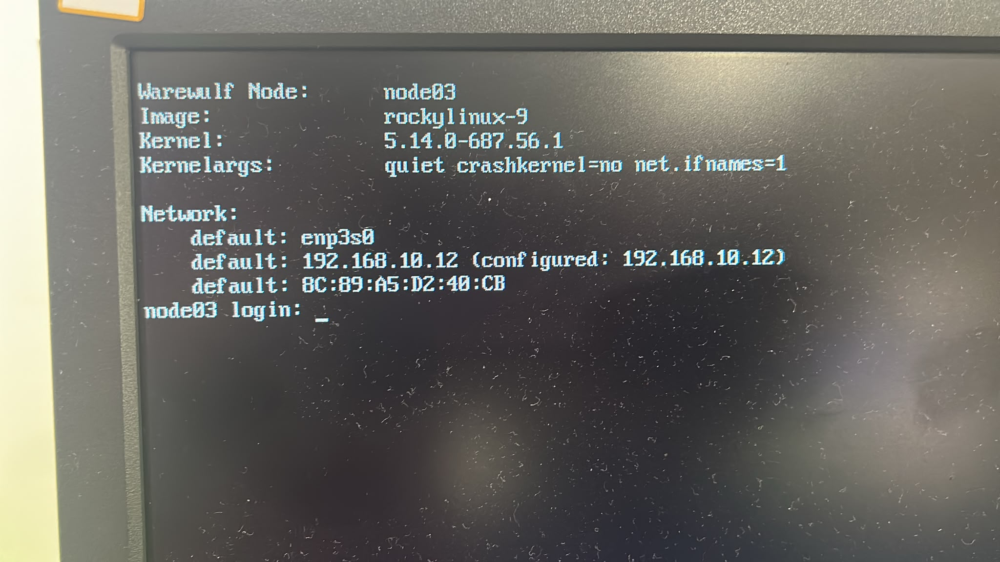
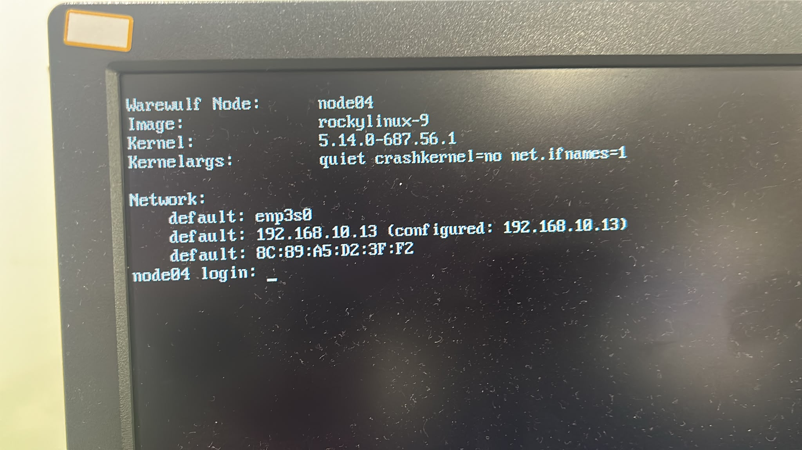
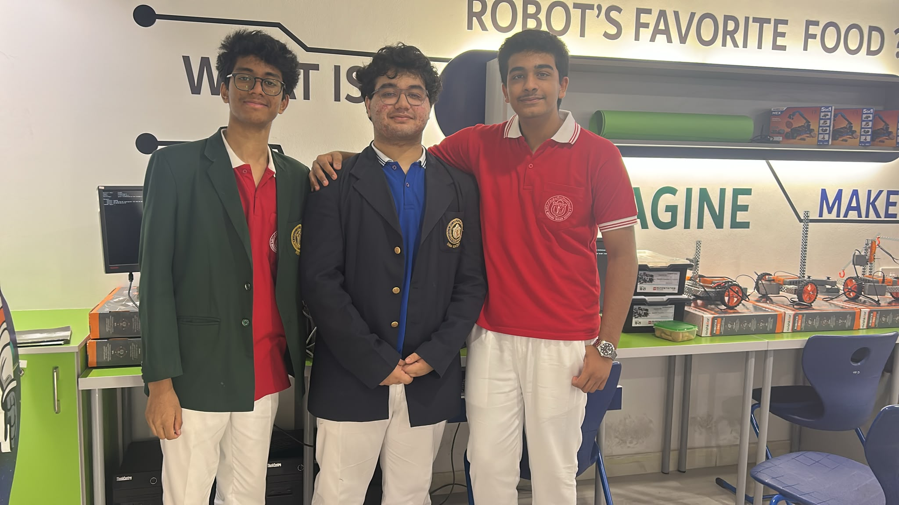

# Project photo gallery

**Project:** Five-node OpenHPC cluster infrastructure · **Photo capture date:** Not provided

This gallery records the physical setup and console screens supplied by the project team. It supplements, but does not replace, the command-based evidence in [Validation](VALIDATION.md) and [Live Configuration](LIVE_CONFIGURATION.md). Captions describe what is visible; they do not establish unseen tests or historical dates.

## Entire cluster

*Cluster overview — rear view showing the connected machines and cabling.*

*Cluster overview — a second angle of the five-desktop installation.*

## Network switch

*TP-Link LiteWave LS1016G unmanaged 16-port Gigabit switch. Indicator lights and connected cables are visible; port-to-node mapping and network performance are not determined from this image.*

## Compute-node consoles

The four screens display Warewulf node identity, the `rockylinux-9` image, Linux kernel `5.14.0-687.56.1`, the `enp3s0` interface, and their configured private addresses at the login prompt. These images are **console observations**, not proof of successful provisioning after a supervised power-cycle test.

### node01 — 192.168.10.10

### node02 — 192.168.10.11

### node03 — 192.168.10.12

### node04 — 192.168.10.13

## Team photo

*Project team photograph in the robotics lab. Individual identities are not assigned to positions in the image.*

## Publication considerations

The console photos display internal node IP/MAC addresses. The group photo shows recognizable students and a school setting. **Confirm school authorization and the consent of everyone pictured before publishing these files in a public repository.** The images have no embedded EXIF metadata in the copies supplied for this update.
