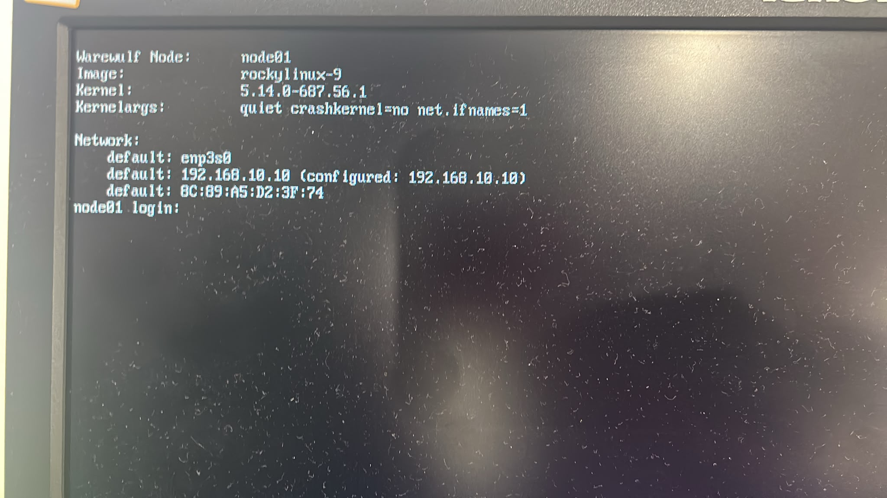

# Warewulf, PXE, node records, and overlays

**Observed**, not assumed: Warewulf `4.7.0-1`, image `rockylinux-9`, profile `default`, active admin interface `enp3s0`, nodes `node01`–`node04` at `192.168.10.10`–`.13` on a `/24`. The IP/DHCP information comes from `wwctl`, `/etc/warewulf/warewulf.conf`, and the generated DHCP configuration.

## Image, profile and overlays

- Image: `rockylinux-9`.
- Profile: `default`; it is automatically included for each node. `ImageName` resolves to `rockylinux-9`.
- Node configuration: system overlay list `wwinit,wwclient,hosts,fstab,hostname,ssh.host_keys,issue,resolv,udev.netname,systemd.netname,ifcfg,ifupdown,NetworkManager,wicked,ignition`.
- Runtime overlay list: `host,hosts,syncuser,rootkey`.
- Profile network device: `enp3s0`, netmask `255.255.255.0`; node-specific IPs/MACs are in `wwctl node list -a`.
- Profile fstab resources: `/home` → `warewulf:/home` as NFS; `/opt` → `warewulf:/opt` with `defaults,noauto,nofail,ro`.
- Provisioning uses `dhcpd` and TFTP/iPXE; DHCP dynamic range `.100`–`.200` does **not** include the fixed node addresses `.10`–`.13`.

`SUPERSEDED` beside `ImageName` in the `wwctl` output indicates the displayed value's source/override context, not a failed image. An overlay named `rootkey` exists, and `warewulf:secure` is `false`. **Do not publish overlay contents, inspect private keys in public output, or assume a particular method of distributing the Munge key.** The historical overlay commands are not evidence of the current key-delivery mechanism.

## Photographic node-console evidence



*Example console at the `node01` login prompt. Equivalent photographs for `node02`–`node04` appear in the [photo gallery](PHOTO_GALLERY.md). These photographs show the console state when captured; they are not a controlled fresh-PXE-reboot validation.*

## Observational commands (read only)

```bash
sudo wwctl version
sudo wwctl image list
sudo wwctl profile list -a
sudo wwctl node list -a
sudo wwctl overlay list
```

The `node list -a` output contains hardware MAC addresses and other identifiers; sanitize before posting externally. Do **not** rerun the historical `node add`, `image import`, `overlay build`, or `wwctl configure --all` commands on the active cluster. They can alter state. No fresh PXE boot after power cycle was performed in this audit; recovery remains **unverified**.

For exact observed Warewulf keys, see [`../warewulf/warewulf.conf`](../warewulf/warewulf.conf). The `dhcpd.conf.reference` file was generated by Warewulf and should not be treated as the source of truth for manual DHCP editing.
